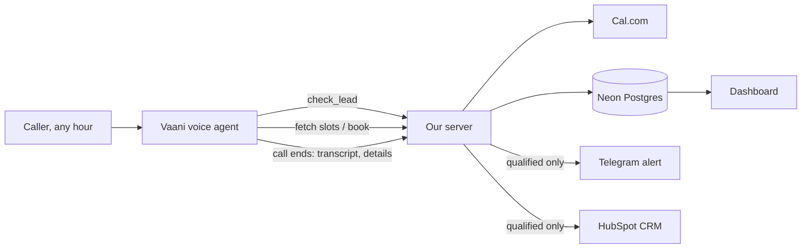
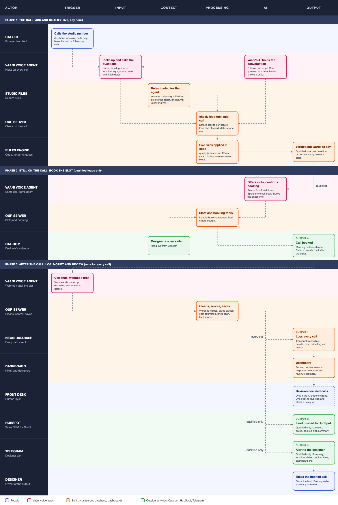

# Aangan Studio: AI lead qualification system

**Live dashboard:** https://aangan-studio-eight.vercel.app  
**Code:** https://github.com/yashvigadawork-prog/aangan-studio

An AI voice agent answers every incoming enquiry call at Aangan Studio (Pune), 24/7. It qualifies the caller against the owner's rules, books a designer consultation while still on the call, and hands the lead to the right people afterwards.

**The problem:** about 200 enquiries a month, 48% get no reply within 48 hours, a third arrive outside office hours, and a reply within an hour converts 4x better.

## How it works



**Phase 1, qualify (live).** The agent collects name, email, property type, location, size, scope, start and finish dates. The `check_lead` tool sends them to the server, where Nikhil's five rules (`src/qualify.js`) decide: ask one more question, decline kindly, or go on to book. Unclear answers pass through with a note, because rejecting a good lead costs more than passing a bad one.

**Phase 2, book (live, qualified only).** The agent reads real free slots from Cal.com, the caller picks one, and the server books it. Cal.com emails the invite.

**Phase 3, log, notify, review (every call).** When the call ends, Vaani posts the transcript, recording and details to `/api/webhook/vaani`. Every call is saved to Postgres with its cost. Qualified leads also create a HubSpot contact and a Telegram alert for the designer. The dashboard shows declined calls so the front desk can re-qualify any with one click.

### Component map


The same map as an editable vector file: [`docs/component-map.svg`](docs/component-map.svg).

### The pricing rule
The agent must never quote a price. It is never given the studio's internal `pricing.md` (not included in this repo), so it cannot leak one, and it is only given the one allowed reply. As a safety net, `src/pricingGuard.js` scans everything the agent said and flags any call where it looks like a price was mentioned.

## Stack (all free tiers, except Vaani which the institution provides)
| Part | Tool |
|---|---|
| Voice agent | Vaani Voice AI |
| Backend | Node.js, Express |
| Database | Neon Postgres |
| Booking | Cal.com |
| CRM | HubSpot (free) |
| Designer alerts | Telegram Bot API |
| Dashboard | HTML, Chart.js, served by the same server |
| Hosting | Vercel |

**One deliberate change from the brief:** booking uses Cal.com instead of Google Calendar. Google blocks service accounts from sending invites to attendees without domain-wide delegation, and Cal.com sends invites, reschedule and cancel links itself.

## Project layout
```
api/index.js           Vercel entry point
src/server.js          Express app
src/qualify.js         Nikhil's five rules (pure function, fully tested)
src/leadCheck.js       Mid-call decision: ask / decline / book
src/normalize.js       Cleans Vaani's data and maps free text onto our values
src/dates.js           "immediately", "by March" -> real dates
src/pricingGuard.js    Flags any price the agent says
src/config.js          Every business number in one place
src/routes/            webhook, booking tools, dashboard API
src/services/          Telegram, HubSpot, Cal.com
dashboard/index.html   Nikhil's dashboard
db/schema.sql          Tables
db/seed-demo.js        Loads the 17 real September phone calls as labelled demo data
knowledge/             services.md, qualified.md, Vaani agent script (the internal pricing.md is kept out of the repo on purpose)
test/                  Automated tests
```

## Run it locally
```bash
npm install
cp .env.example .env      # then fill in the values
npm run db:setup          # creates the tables
npm run seed:demo         # optional: demo data (npm run seed:clear removes it)
npm test
npm start                 # http://localhost:3000
```
To let Vaani reach a local server, expose it with ngrok. For a permanent address, deploy to Vercel (`vercel deploy --prod`), add the variables below in the Vercel project settings, and point Vaani's tools and webhook at the deployment URL.

## Environment variables
See `.env.example`: `DATABASE_URL`, `WEBHOOK_SECRET`, `TELEGRAM_BOT_TOKEN`, `TELEGRAM_CHAT_ID`, `HUBSPOT_ACCESS_TOKEN`, `CAL_API_KEY`, `CAL_EVENT_TYPE_ID`, `DASHBOARD_URL`.

Vaani authenticates to this server with `WEBHOOK_SECRET`, sent in the `x-webhook-secret` header or as `?secret=` in the URL.

## Tests
`npm test` runs 37 tests. The qualification rules are tested against the 17 phone calls from the September 2026 enquiry log, so the scoring is checked on real data.

## Assumptions to confirm with Nikhil
These live in `src/config.js`:
- Minimum commercial size 500 sq ft (taken from one real call; `services.md` only gives the 3,000 sq ft maximum)
- Budget floors that count as "clearly too low"
- Minimum lead time of 6 weeks
- The 5% baseline conversion behind the dashboard's revenue estimate
- Consultation days and hours (set in Cal.com)

The rules in `services.md` and `qualified.md` were translated by hand into code, so editing the markdown files does not change behaviour until `config.js` is updated.

## Limits
- Only incoming phone calls are in scope (no WhatsApp or web form).
- The dashboard has no login, by design for this submission. Add authentication before using it with real callers.
- Browser test calls in Vaani carry no caller phone number; real phone calls do.
